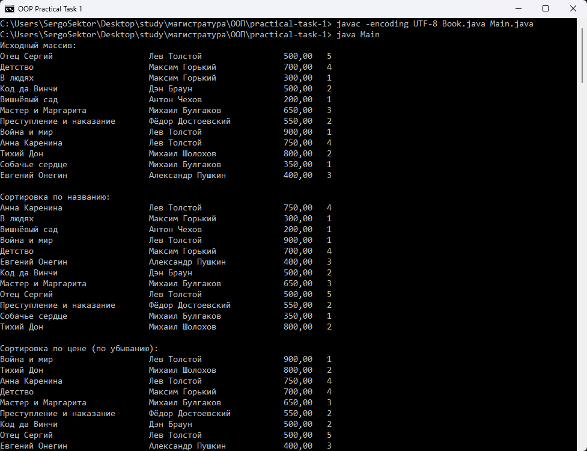

# Практическое задание 1

Массив из 12 объектов класса `Book` с полями разных типов:

- `String name` — название;
- `String author` — автор;
- `float price` — цена;
- `int edition` — номер издания.

Реализовано в стиле лекции:

- конструктор с ключевым словом `this`;
- методы `print()` и `printToFile(PrintStream)`;
- ручная сортировка выбором по названию, цене (по убыванию) и номеру издания;
- запись массива в файл `books.txt` через `PrintStream` и `printf`.

## Запуск

```bash
javac -encoding UTF-8 Book.java Main.java
java Main
```

## Демонстрация


