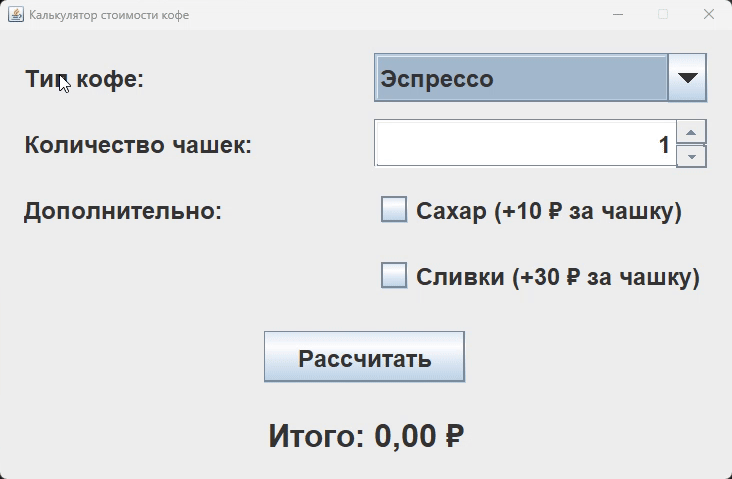

# Практическое задание 2

GUI-приложение на Java Swing для расчёта стоимости кофе.

Исходные данные выбираются в окне:

- тип кофе;
- количество чашек;
- наличие сахара;
- наличие сливок.

Итоговая стоимость выводится в окне программы, консоль не используется.

## Запуск

```bash
javac -encoding UTF-8 CoffeeType.java CoffeeCalculator.java
java CoffeeCalculator
```

## Демонстрация


