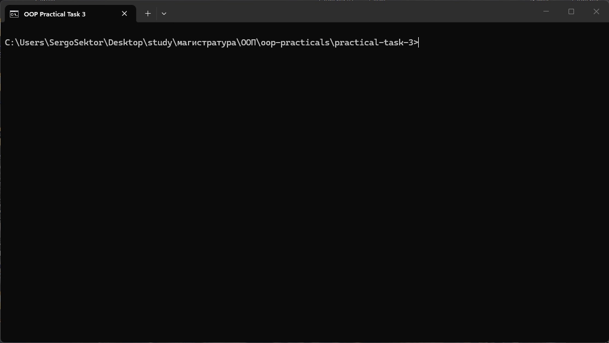

# Практическое задание 3

Целочисленные бинарные операции DIV, MOD, НОД, НОК.

Интерфейс `IOperation` и четыре класса, реализующие операции:

- `Div` — целочисленное деление (`DIV`);
- `Mod` — остаток от деления (`MOD`);
- `Gcd` — наибольший общий делитель (НОД);
- `Lcm` — наименьшее общее кратное (НОК).

```java
public interface IOperation {
    String getName();

    String getSign();

    int estimate(int a, int b);
}
```

Класс `UI` создаёт массив `IOperation[]` и в цикле выводит название операции, выражение и результат. `Div` и `Mod` проверяют делитель на ноль, `Gcd` и `Lcm` работают с модулями чисел.

## Запуск

```bash
javac -encoding UTF-8 *.java
java UI
```

## Демонстрация


