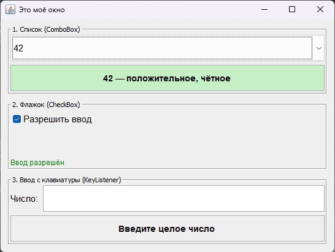

# Практическое задание 4

Обработка событий элементов управления. Приложение на Java Swing «Оценка числа».

Реализованы три привязки к событиям (без кнопок):

1. `JComboBox` + `ActionListener` (`ComboListener`) — при выборе числа показываются его знак и чётность. Результат окрашивается: положительное число — зелёным, отрицательное — красным, ноль — серым.
2. `JCheckBox` + `ActionListener` (`CheckListener`) — снятие флажка блокирует список и поле ввода, статус меняется на «Ввод заблокирован».
3. `JTextField` + `KeyListener` (`TypingListener`) — результат пересчитывается после каждого нажатия клавиши: число классифицируется и окрашивается.

Модель — `NumberInfo`, представление — `Main`, поведение — классы-слушатели.

## Запуск

```bash
javac -encoding UTF-8 *.java
java Main
```

## Демонстрация


