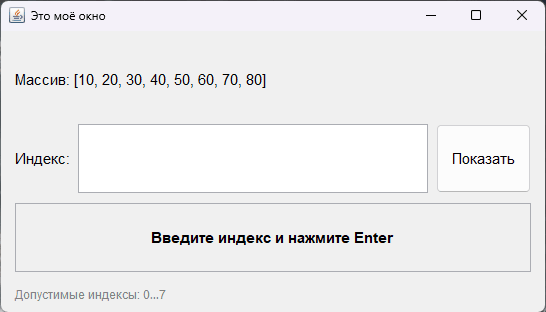

# Практическое задание 5

Обработка исключений. Приложение на Java Swing демонстрирует работу с массивом: пользователь вводит индекс, программа выводит значение элемента, а при некорректном вводе перехватывает исключения.

В приложении используются два вида исключений:

- `NumberFormatException` — введённый текст не является целым числом;
- `ArrayIndexOutOfBoundsException` — индекс находится за пределами массива.

Ошибки перехватываются в `LookupListener` и показываются пользователю через `JOptionPane`. Поле результата при этом окрашивается в красный цвет, а при успешном поиске — в зелёный.

Структура:

- `ArrayInfo` — модель: массив значений и его текстовое представление;
- `ResultField` — поле результата с цветовой индикацией;
- `LookupListener` — обработка ввода и исключений;
- `Main` — окно и компоновка интерфейса.

Каждое следующее значение можно вводить сразу после предыдущего: после попытки текст в поле выделяется, поэтому новый ввод заменяет старый.

## Запуск

```bash
javac -encoding UTF-8 *.java
java Main
```

## Демонстрация


