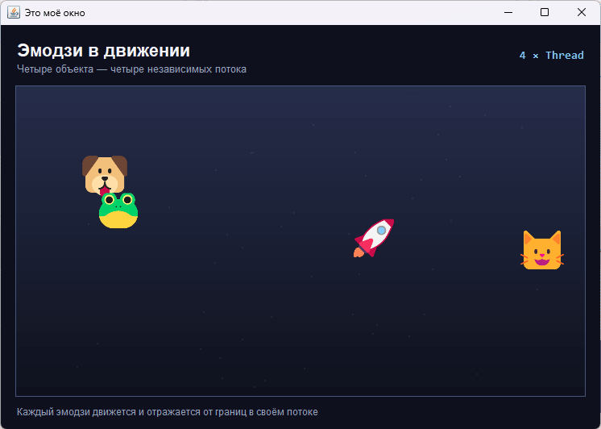

# Практическое задание 6

Многопоточность. Приложение на Java Swing, в котором по полю одновременно движутся четыре эмодзи. Каждый объект живёт в собственном потоке и независимо отражается от границ панели.

Структура:

- `EmojiRunner` — поток одного эмодзи: движение, отражение от стенок и запрос перерисовки;
- `RacePanel` — поле с градиентным фоном и отрисовкой всех объектов;
- `EmojiSprites` — загрузка спрайтов из папки `emoji`;
- `Main` — окно, заголовок и запуск потоков.

Всего создаётся четыре потока: `Кот`, `Пёс`, `Ракета` и `Лягушка`. Потоки являются демонами, поэтому завершаются вместе с приложением.

Эмодзи подключаются как PNG-спрайты: стандартные средства Java 2D не отображают цветные эмодзи-шрифты, а спрайты сохраняют привычный вид.

## Запуск

```bash
javac -encoding UTF-8 *.java
java Main
```

## Демонстрация


